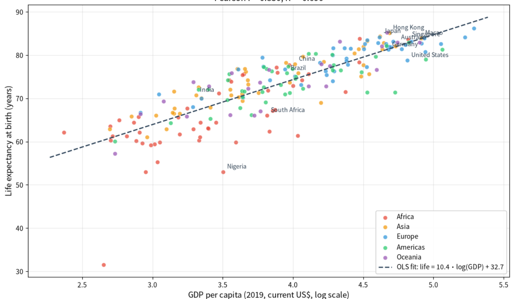

# Mo Yehua's Data Science Portfolio

## About Me
Hello! I am a Data Science / Business Analytics student. I am passionate about turning raw data into actionable insights and telling stories through visualizations. My goal is to become a professional data analyst, using Python to build reproducible, decision-relevant analyses that connect public data to real-world questions. 

## Technical Skills
- **Programming & Data Manipulation:** Python (Pandas, NumPy, SciPy)
- **Data Visualization:** Matplotlib, Seaborn
- **Machine Learning & Modeling:** Scikit-Learn (Linear Regression, Ridge, Cross-Validation)
- **Tools & Workflows:** Jupyter Notebook, Git/GitHub, API Data Acquisition

## Project Showcase

### National Wealth and Longer Lives: How Strongly Is GDP per Capita Associated with Life Expectancy across the World?
**Research Question:** 
To what extent is GDP per capita associated with life expectancy at birth across countries, and which additional socio-economic factors best explain the remaining differences?

**Visualization:**

**Key Finding:** 
There is a strong positive correlation between national wealth and life expectancy. Specifically, using a log transformation for GDP per capita reveals a much stronger relationship (Pearson r ≈ 0.83, R² ≈ 0.69) than raw GDP (r ≈ 0.60). This indicates that the relationship is curvilinear—initial increases in wealth yield significant health benefits, but the returns gradually diminish as countries become wealthier. 

**Project Status:** 
Ongoing (Currently transitioning from EDA to multiple regression modeling)

**Project Repository:** 
[Link to the Project Repository](https://github.com/MOYEHUA/data-science-project)

---
*This portfolio was built for CISC7204 Data Analytics with Python.*
